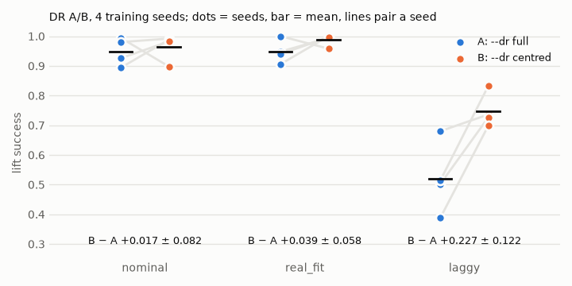

# so-arm100-rl

PPO for the SO-ARM100 lift task on [so-arm100-sim](https://github.com/AungKaung1928/so-arm100-sim), CPU only, scored on physics it never trained on: a domain-randomised fine-tune halves the mean held-out drop (0.120 → 0.056), and DR centred on real-arm fits leads under 3-step lag in all four seeds (+0.227 ± 0.122).



| method | metric | value | condition |
|---|---|---|---|
| PPO, lift from scratch, nominal | steps to lift ≥ 0.6 (rolling 100) | 0.996 M | seed 0; final eval 1.00 over 20 episodes |
| PPO, curriculum reach → push → lift | steps to lift ≥ 0.6 | not reached in 20 M | stuck on push; 0.45 on push, lift never started |
| nominal-trained policy | mean drop vs own nominal | 0.120 | 6 held-out cells |
| DR fine-tuned policy (+10 M steps) | mean drop vs own nominal | 0.056 | 6 held-out cells |
| ONNX export (DR fine-tune) | 1-thread latency p50 / p99 | 0.008 / 0.015 ms | n = 2000; max \|torch − onnx\| 2.1e-6; 298 kB / 73,990 parameters |

The curriculum never reached lift, DR from scratch stalled, and every number is one simulated arm, not hardware. Per-cell tables, the DR A/B and what failed: [docs/DETAILS.md](docs/DETAILS.md). Walkthrough: https://aungkaung1928.github.io/projects/so-arm100.html

## Quick start

Linux, Python 3.11+ (onnxruntime 1.30 has no 3.10 wheel; Ubuntu: the `python3-venv` package), CPU only.

```bash
git clone <this repo URL>
cd so-arm100-rl
python3 -m venv .venv && . .venv/bin/activate                       # first time only
pip install torch==2.11.0 --index-url https://download.pytorch.org/whl/cpu   # first time only
pip install -r requirements.txt && pip install -e .                 # first time only, pulls the bench at a pinned commit
python -m pytest -q tests      # 53 passed, 1 skipped (plot test needs matplotlib) in ~40 s: README numbers vs runs/*.json, env and PPO tests
```

Training, evaluation, ONNX export and Docker: [docs/DETAILS.md#reproducing](docs/DETAILS.md#reproducing).

## How it works

1. `train.py`: PPO, 8 forked MuJoCo processes with one thread each; `--dr none | full | real | centred | both` picks the randomisation ranges.
2. `eval_gap.py` / `compare_gap.py`: 100 episodes × 5 seeds per held-out physics cell (heavy, weak, laggy, noisy, small).
3. `dr_ab.py`: pairs DR arms by training seed and reports mean ± sd of the difference.

## License

MIT, see LICENSE.
